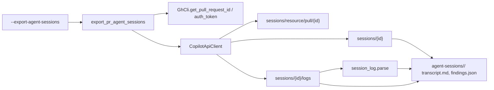
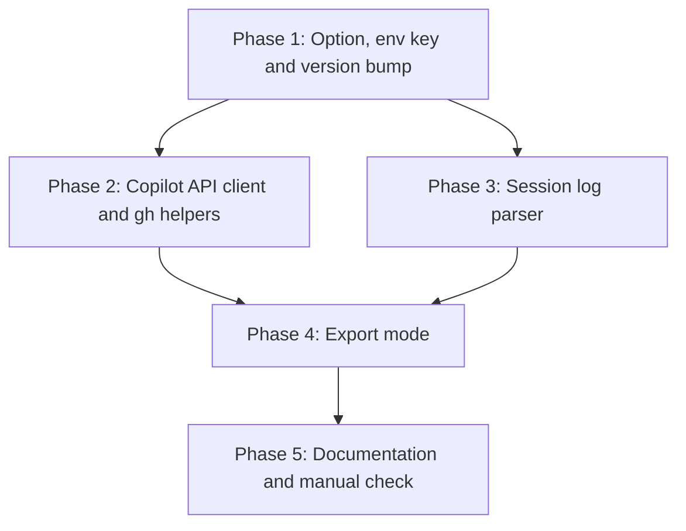

# Implementation Plan: Export Copilot Agent Sessions for a PR

## Overview

Add a fifth export mode. Phase 1 adds the option and the version bump. Phases 2 and 3 build two independent, pure-ish units: the Copilot API client with its `gh` helpers, and the session-log parser. Phase 4 joins them in `export_pr_agent_sessions` and wires it into `main`. Phase 5 documents the mode and runs the manual check against a real PR.

## Affected Files

| File | Change Type | Description |
| ---- | ----------- | ----------- |
| `src/prinfo/config.py` | Update | `export_agent_sessions` field, env key, `--skip-check-logs` companion |
| `src/prinfo/cli.py` | Update | New flag, mode registration, summary logging |
| `src/prinfo/gh.py` | Update | `get_pull_request_id`, `auth_token` |
| `src/prinfo/copilot.py` | Create | Host mapping, `CopilotApiClient`, `CopilotApiError` |
| `src/prinfo/session_log.py` | Create | SSE parsing, transcript rendering, findings extraction, metadata curation |
| `src/prinfo/exporter.py` | Update | `export_pr_agent_sessions`, `AgentSessionExportResult` |
| `tests/test_config.py` | Update | Flag and env resolution, companion rule |
| `tests/test_cli.py` | Update | Mode wiring, failure isolation |
| `tests/test_gh.py` | Update | New `GhCli` methods |
| `tests/test_copilot.py` | Create | Client and host mapping |
| `tests/test_session_log.py` | Create | Parser |
| `tests/fixtures/agent_session_log.sse` | Create | Synthetic log fixture |
| `tests/test_exporter.py` | Update | End-to-end mode tests with fakes |
| `README.md` | Update | Option, env key, outputs, host mapping, skip reasons |
| `skills/prinfo/SKILL.md` | Update | New mode in workflow and constraints |
| `skills/prinfo/references/commands.md` | Update | Command recipe |
| `skills/prinfo/references/outputs.md` | Update | Output file reference |
| `skills/prinfo/references/troubleshooting.md` | Update | Skip reasons and access failures |
| `pyproject.toml` | Update | Version `0.5.0` |
| `uv.lock` | Update | Refreshed by `uv lock` |

## Phase 1: Option, env key and version bump

Requirements: REQ-1, REQ-8

### Implementation Work - Phase 1

- `src/prinfo/config.py`: add `export_agent_sessions: bool` to `AppConfig`, resolved with `_resolve_bool` from `args.export_agent_sessions` and `PRINFO_EXPORT_AGENT_SESSIONS`. Add it to the `--skip-check-logs` companion check, and list it in that error message.
- `src/prinfo/cli.py`: add the `--export-agent-sessions` `store_true` argument with help text, and add the mode to the `--skip-check-logs` help text. Register no mode runner yet.
- `pyproject.toml`: `version = "0.5.0"`, then run `uv lock`.

### Test Work - Phase 1

- `tests/test_config.py`: flag on, env key on, CLI flag overriding the env value, and `--skip-check-logs` accepted with only `--export-agent-sessions`.
- `tests/test_cli.py`: the parser accepts the flag, and the help text mentions it.

### Verification - Phase 1

- `uv run pytest tests/test_config.py tests/test_cli.py -q` passes.
- `uv run prinfo --version` prints `prinfo 0.5.0`.

## Phase 2: Copilot API client and gh helpers

Requirements: REQ-3

### Implementation Work - Phase 2

- `src/prinfo/copilot.py`:
  - `copilot_api_base_url(gh_host: str) -> str | None` implementing the mapping from REQ-3.
  - `class CopilotApiError(RuntimeError)` with `status: int | None` and `path: str`. The message is built from the method, path and status only.
  - `class CopilotApiClient(base_url, token_provider: Callable[[], str], opener=None, user_agent=...)`, with `list_pr_sessions(pr_database_id) -> list[dict]`, `get_session(session_id) -> dict` and `get_session_log(session_id) -> bytes`. The token provider is called lazily once and cached in a private attribute. The header is built in one private method. `urllib.error.HTTPError` and `URLError` are mapped to `CopilotApiError` without copying headers.
- `src/prinfo/gh.py`:
  - `GhCli.get_pull_request_id(repo: str, pr_number: int) -> int` through `_run_json` on `repos/{owner}/{name}/pulls/{n}`.
  - `GhCli.auth_token() -> str`, which returns `GH_TOKEN` from `env_overrides` when set, else the stripped stdout of `gh auth token --hostname <host>`. It raises `GhCliError` when the result is empty, and never logs it.

### Test Work - Phase 2

- `tests/test_copilot.py`:
  - Host mapping for `github.com`, `example.ghe.com` and `github.example.com`.
  - Requests go to the right URLs with a bearer header, through a fake opener.
  - 401, 403, 404 and 500 map to `CopilotApiError.status`.
  - A sentinel token is absent from `str(error)` and `repr(error)`.
  - The token provider is called once.
- `tests/test_gh.py`: `get_pull_request_id` parses `id`; `auth_token` prefers the explicit token, falls back to the runner output, and raises on empty output.

### Verification - Phase 2

- `uv run pytest tests/test_copilot.py tests/test_gh.py -q` passes.
- `uv run ruff check .` is clean.

## Phase 3: Session log parser

Requirements: REQ-5, REQ-4

### Implementation Work - Phase 3

- `src/prinfo/session_log.py`:
  - `parse_session_log(raw: bytes) -> ParsedSessionLog`, a frozen dataclass with `events: list[TranscriptEvent]`, `findings: list[dict]` and `unparsed_events: int`.
  - `render_transcript(parsed, *, session_id) -> str`, with argument truncation at 4000 characters and a truncation note.
  - `findings` mapping from `store_comment` arguments to the REQ-5 keys, with unknown keys under `extra`.
  - `curate_session_metadata(raw: dict) -> dict`, implementing the REQ-4 allow-list and the `event_identifiers` decoding. Living in this module keeps the exporter thin.
- `tests/fixtures/agent_session_log.sse`: a synthetic stream with assistant content, `view` and `rg` tool calls, one `store_comment` with `suggested_fix`, one with `fix_skip_reason`, and one malformed `data:` line. It holds no real repository, user or tenant data.

### Test Work - Phase 3

- `tests/test_session_log.py`:
  - Event order, finding count and fields, and `unparsed_events == 1` for the fixture.
  - A log with no `store_comment` calls has no findings.
  - Truncation note when arguments are long.
  - Unknown argument keys kept under `extra`.
  - `curate_session_metadata` drops every non-allow-listed key, including a planted `user_login` and `settings`, and decodes `review_pass` and `head_sha` from `event_identifiers`.

### Verification - Phase 3

- `uv run pytest tests/test_session_log.py -q` passes.
- `uv run ruff check .` is clean.

## Phase 4: Export mode

Requirements: REQ-2, REQ-4, REQ-6, REQ-3

### Implementation Work - Phase 4

- `src/prinfo/exporter.py`:
  - `@dataclass(frozen=True) class AgentSessionExportResult` with `manifest_path`, `exported_sessions`, `skipped_sessions` and `findings_count`.
  - `export_pr_agent_sessions(config, gh, client_factory=None) -> AgentSessionExportResult`, which:
    1. Resolves the repo as the other modes do.
    2. Computes the base URL. When it is `None`, writes the manifest with a mode-level skip (`unsupported_host`) and returns.
    3. Reads the PR database id and lists the sessions. On `CopilotApiError` 401 or 403, records `no_copilot_access`; on 404, records `no_sessions_endpoint`. In both cases it writes the manifest and returns.
    4. For each session in `(created_at, id)` order, validates the id, fetches metadata and the log, and writes `session.json`, `log.sse`, `transcript.md` and, when there are findings, `findings.json`. A per-session failure appends to `skipped_sessions`.
    5. Raises `ExportError` when sessions were listed but none exported.
    6. Writes `agent-sessions.json`.
  - `client_factory` defaults to building `CopilotApiClient(base_url, gh.auth_token)`. Tests inject a fake.
- `src/prinfo/cli.py`: register the `"agent sessions"` mode, and extend `_log_mode_summaries` with exported and skipped session counts, using `_log_skip_severity`. Access and host skips log at `WARNING`; an empty session list logs at `INFO`.

### Test Work - Phase 4

- `tests/test_exporter.py`:
  - Two sessions, given out of order, are exported in order.
  - An empty session list gives `sessions: []`.
  - Unsupported host: no client call is made.
  - 401, 403 and 404 give their reason codes.
  - One session's log failing is skipped while the other is exported.
  - All sessions failing raises `ExportError`.
  - `log.sse` is byte-identical to the served log.
  - `session.json` holds the curated keys only.
  - Sentinel-token scan over captured logs (`caplog`), exception text and every file under `output_dir`.
- `tests/test_cli.py`: the mode runs when the flag is set. A failing agent-sessions mode does not stop `--export-comments` from exporting, and the exit code is 0 when the other mode succeeded.

### Verification - Phase 4

- `uv run pytest -q` passes.
- `uv run ruff check .` is clean.

## Phase 5: Documentation and manual check

Requirements: REQ-7, REQ-2, REQ-3, REQ-5

### Implementation Work - Phase 5

- `README.md`:
  - Add the option to Quick start, `PRINFO_EXPORT_AGENT_SESSIONS` to the supported env keys, and the new mode to the `--skip-check-logs` paragraph.
  - Output section: the `agent-sessions/` layout, the manifest keys, the curated `session.json` keys, the transcript and findings format, the host mapping, the skip reason codes, and a note that the Copilot API endpoints are undocumented.
- `skills/prinfo/SKILL.md`: add the mode to the description, the workflow step list, the constraints and the failure buckets.
- `skills/prinfo/references/commands.md`: recipe `prinfo --repo HOST/OWNER/REPO --gh-host HOST --pr N --export-agent-sessions --skip-check-logs`.
- `skills/prinfo/references/outputs.md`: the agent-sessions file reference.
- `skills/prinfo/references/troubleshooting.md`: `no_copilot_access`, `no_sessions_endpoint`, `unsupported_host`, per-session skip codes, and `gh auth token` failures.
- Manual run against a real PR that has Copilot review sessions, with output written outside the repository.

### Test Work - Phase 5

- None beyond the existing suite. Documentation is verified by lint and by the manual run.

### Verification - Phase 5

- `markdownlint-cli2 "**/*.md" "#node_modules"` is clean.
- The manual run writes the manifest, one folder per session and a non-empty `findings.json` for at least one session.

## Traceability

| REQ | Phase | Acceptance Criteria |
| --- | ----- | ------------------- |
| REQ-1 | Phase 1 | AC-1 |
| REQ-2 | Phase 4, Phase 5 | AC-2, AC-10 |
| REQ-3 | Phase 2, Phase 4, Phase 5 | AC-3, AC-4, AC-10 |
| REQ-4 | Phase 3, Phase 4 | AC-4, AC-5 |
| REQ-5 | Phase 3, Phase 5 | AC-6, AC-10 |
| REQ-6 | Phase 4 | AC-7 |
| REQ-7 | Phase 5 | AC-8 |
| REQ-8 | Phase 1 | AC-9 |

## Dependency Graph

Phases 2 and 3 can run in parallel.

## Estimated Scope

| Phase | Source Files | Test Files | Effort |
| ----- | ------------ | ---------- | ------ |
| Phase 1 | 3 | 2 | Small |
| Phase 2 | 2 | 2 | Medium |
| Phase 3 | 1 | 2 | Medium |
| Phase 4 | 2 | 2 | Medium |
| Phase 5 | 5 | 0 | Small |
